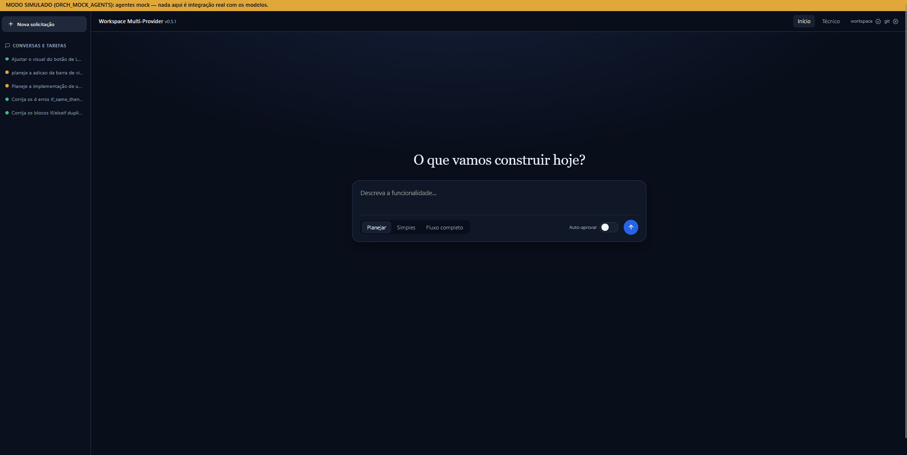
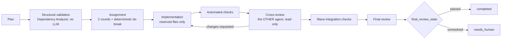

# SINESTRO

[](https://github.com/felipevaleriorocha/sinestro/actions/workflows/ci.yml) [](#roadmap) [](#) [](LICENSE)

**English** | [Português (Brasil)](README.pt-BR.md)

> **A unified workspace for AI collaboration.**

SINESTRO is a **local, autonomous multi-agent orchestrator** for coordinating software engineering workflows with AI agents that plan, implement, and **review one another's work**. Agents communicate through the **A2A 1.0** protocol using structured data contracts and deterministic validation rather than relying on unstructured chat.



> **Core rule:** an agent that implements a task must never review its own work. Cross-review is assigned to a different, independent agent.

## Current implementation

| Agent | Execution channel | Main configuration |
|---|---|---|
| **Gemini** | Antigravity CLI (`agy`), through a controlled subprocess | `AGY_MODEL` |
| **DeepSeek** | Local HTTP API / OpenCode Engine | `OPENCODE_MODEL` |

Models and providers are configured declaratively through environment variables (`.env`). The orchestration core is not intended to be permanently tied to a specific model.

**Current version:** `0.5.2` · **SQLite schema:** `7`

The current implementation includes static dependency analysis through the **Dependency Analyzer**, deterministic execution that is sequential by default (`PARALLEL_EXECUTION=false`), stage tracking through `stage_log`, and resource/tool isolation support through the **Model Context Protocol (MCP)**.

> **Development status:** SINESTRO is under active development. Features, configuration, and APIs may change. The multi-provider workspace described in the roadmap is the project's direction; not every capability is implemented yet.

## Task execution workflow

```text
1. Planning               The planning agent breaks the goal into structured subtasks with verifiable acceptance criteria.
2. Structural validation The Dependency Analyzer validates the task DAG without an LLM; one plan-reformulation attempt is allowed if validation fails.
3. Assignment             Round 1: an agent proposes an assignment. Round 2: the other agent accepts or raises a technical objection.
                          Deterministic tie-breaking uses config/assignment_rules.json.
4. Implementation         The assigned agent works strictly within reserved files and resources.
5. Automated checks       Linters, static analyzers, and local tests run before LLM-based reviews.
6. Cross-review           The OTHER agent reviews in read-only mode, providing strict evidence: file, line, and code excerpt.
7. Wave integration       Automated checks validate the combined files produced by a topological group.
8. Final review           Global integration review checks interfaces, contracts, consistency, and shared state.
```



Conflict-resolution hierarchy: **automated checks > reviewer with verifiable evidence > human escalation (`needs_human`)**.

## Final review states

The `final_review_state` field is persisted explicitly. The pure function `final_status()` in `orchestrator/task_manager.py` is the single authority for workflow status transitions:

| `final_review_state` | Workflow status (when subtasks are approved) |
|---|---|
| `passed` | `completed` |
| `disabled` (`FINAL_REVIEW=false`) | `completed` (with final review marked as disabled) |
| `accepted_by_human` | `completed` |
| `skipped` / `failed` | `completed_unreviewed` (**Resume** runs the pending final review only) |
| `changes_requested` / `rejected` / `unverified` / `invalidated` | `needs_human` |
| `rejected_by_human` | `failed` |

If all subtasks were implemented by one agent, the other agent takes responsibility for the entire final review. When authorship is mixed, the reviewer's approval applies only to tasks implemented by the other agent. Tasks authored by the reviewer are explicitly recorded in `self_authored_subtasks` for auditable coverage.

## Requirements

- Python 3.11 or later (`py -3 --version` or `python3 --version`).
- Antigravity CLI (`agy`), configured and authenticated.
- OpenCode Engine or a compatible local inference server.
- Git available on `PATH` (used strictly in **read-only mode** for snapshots and diffs).
- Optional: local static-analysis tools and linters (configured in `config/checks.json`).
- Optional: Node.js (only for the dashboard's static-rendering test suite).

## Quickstart (no `agy` or OpenCode required)

Mock agents let you run the whole workflow, dashboard and API without any model, token or external CLI. Nothing in this mode is a real integration.

```bash
python -m venv .venv && .venv/bin/python -m pip install -r requirements.txt   # Windows: .venv\Scripts\python
cp -n .env.example .env   # then set PROJECT_ROOT to an existing empty folder (create it first) and ORCH_MOCK_AGENTS=true
.venv/bin/python run_server.py                                      # Windows: .venv\Scripts\python
```

Open <http://127.0.0.1:8787/dashboard/> and submit a goal, or from a terminal:

```bash
curl -X POST http://127.0.0.1:8787/tasks -H "Content-Type: application/json" \
     -d '{"goal": "Create a hello-world module", "mode": "full"}'
```

See [docs/DEMO.md](docs/DEMO.md) for a guided walkthrough.

## Installation and startup

```bash
git clone <repository-url> sinestro
cd sinestro
cp -n .env.example .env  # Set PROJECT_ROOT and the required credentials
```

On Windows (PowerShell):

```powershell
# Terminal 1: OpenCode support backend (when applicable)
.\run_opencode.ps1

# Terminal 2: Orchestrator (creates .venv and installs dependencies on first run)
.\start.ps1
```

Once the service is running:

- **Operations dashboard:** <http://127.0.0.1:8787/dashboard/>
- **API documentation (OpenAPI/Swagger):** <http://127.0.0.1:8787/docs>

## Startup scripts (Windows)

| Script | What it does |
|---|---|
| `start.bat` | Starts OpenCode and the orchestrator in the background (headless) and opens the dashboard when `/health` answers. |
| `stop.bat` | Stops everything listening on ports 8787 (orchestrator), 4096 (OpenCode) and 34872 (Rojo). |
| `restart.bat` | `stop.bat` followed by `start.bat`. |
| `start.ps1` | Starts only the orchestrator in the foreground (creates `.venv` and installs dependencies on the first run). Also starts `rojo serve` when `PROJECT_ROOT` contains `default.project.json`. |
| `run_opencode.ps1` | Starts only the local OpenCode server, bound to `127.0.0.1`. |
| `scripts/run_tests.ps1` | Test suite with mocks; `-Live` adds real infrastructure checks without tokens, `-LiveTokens` also sends prompts (uses quota). |
| `python run_server.py` | Cross-platform way to start the orchestrator (what `start.ps1` calls). |

## Environment configuration (`.env`)

The `.env` file contains local configuration and secrets. **Never commit it to version control.**

| Variable | Default | Description |
|---|---|---|
| `PROJECT_ROOT` | — | Absolute path to the managed workspace. |
| `OPENCODE_URL` | `http://127.0.0.1:4096` | Local development server endpoint. |
| `OPENCODE_MODEL` | `opencode/deepseek-v4.1-flash-free` | Model identifier (`provider/model`). |
| `OPENCODE_AGENT` | `Build` | Implementation agent persona. |
| `OPENCODE_REVIEW_AGENT` | `Plan` | Read-only persona for planning and analysis. |
| `AGY_BIN` | `agy` | CLI executable or wrapper. |
| `AGY_MODEL` | `gemini-4-argon-high` | Main reasoning/architecture model. |
| `AGY_REVIEW_MODE` | `plan` | `--mode` flag used for strictly analytical tasks. |
| `PARALLEL_EXECUTION` | `false` | Enables concurrency between independent subtasks (safe default: disabled). |
| `MAX_PARALLEL_SUBTASKS` | `1` | Maximum number of concurrent subtasks. |
| `MAX_REVIEW_CYCLES` | `2` | Maximum number of correction cycles requested by a reviewer. |
| `MAX_CHECK_FIX_ATTEMPTS` | `2` | Automatic correction attempts after linter/check failures. |
| `MAX_IMPLEMENTATION_ATTEMPTS` | `4` | Global attempt limit per subtask before escalation. |
| `MAX_BLOCKED_SUBTASKS` | `3` | Defensive workflow pause threshold for blocked subtasks. |
| `FINAL_REVIEW` | `true` | Enables the global integration and final-validation stage. |
| `ORCH_MOCK_AGENTS` | `false` | Set to `true` to use in-memory mock agents for workflow tests. |

## Dependency Analyzer: deterministic task DAG

Before code is executed or delegated, the task plan is analyzed by `DependencyAnalyzer` (`orchestrator/dependency_analyzer.py`). It does not invoke language models or execute processes.

1. **Structural validation:** detects and blocks empty IDs, duplicate IDs, missing references in `depends_on`, dependency cycles, and paths outside the workspace.
2. **Static relationship classification:**
   - `PARALLEL`: task graphs are independent, with no mutual dependency or shared files/resources.
   - `SEQUENTIAL`: an explicit dependency, declared technical uncertainty, or dynamic loading requires ordered execution.
   - `SHARED`: tasks share files, contracts, persistence schemas, or MCP resources.
3. **Topological wave grouping:** orders execution into groups. Even in sequential mode, groups determine resource-reservation order and integration-check boundaries.

## REST API

| Action | Method / endpoint | Payload / description |
|---|---|---|
| Start workflow | `POST /tasks` | `{"goal": "...", "mode": "plan_only" \| "full"}` |
| Get workflow | `GET /tasks/{id}` | Returns status, DAG, events, metrics, and stages. |
| Reanalyze plan | `POST /tasks/{id}/analyze` | Recalculates relationships and topological groups without an LLM. |
| Get operational report | `GET /tasks/{id}/report` | Aggregates stages, changed files, and metrics. |
| Resume workflow | `POST /tasks/{id}/resume` | Resumes blocked, paused, or review-pending workflows. |
| Decide on subtask | `POST /tasks/{id}/subtasks/{sid}/decision` | Human action: `approve`, `retry`, `reassign`, or `reject`. |
| Decide on final review | `POST /tasks/{id}/final-review/decision` | Human action: `accept` or `reject`. |
| Cancel workflow | `POST /tasks/{id}/cancel` | Requests safe cancellation and records the stop audit. |
| Clear agent quota | `POST /agents/{name}/clear-quota` | Resets a persisted cooldown after quota availability is restored. |
| Integration status | `GET /checks/status` | Lists installed and active validation tools. |
| Lock manager | `GET /locks`, `GET /locks/history` | Shows currently reserved resources and the audit history. |

## Tests and validation

Run the complete unit and integration test suite with mocks:

```powershell
.\scripts\run_tests.ps1
```

Run local infrastructure integration tests without consuming model tokens:

```powershell
.\scripts\run_tests.ps1 -Live
```

Run an end-to-end operational test with real models (uses quota; run in an isolated workspace):

```powershell
.\scripts\manual_role_test.ps1 -Implementer deepseek
.\scripts\manual_role_test.ps1 -Implementer gemini
```

## Security and concurrency

- **Network binding:** the service exposes endpoints exclusively on `127.0.0.1`.
- **Data sanitization:** secrets, passwords, and authentication headers are redacted before being written to logs or the database.
- **Workspace boundary:** absolute or relative paths outside `PROJECT_ROOT` are rejected by validation layers.
- **Controlled subprocesses:** arbitrary shell interpreters are not used; executables run with allowlisted, validated argument lists.
- **Atomic reservations (`FileLockManager`):** all-or-nothing reservation of files and `mcp:` resources, with preventive lock retention when external process termination cannot be confirmed.

## Design decisions

- **Cross-review, never self-review.** A model reviewing its own output tends to agree with itself. The implementer and the reviewer are always different agents, and the reviewer must cite file, line and code excerpt.
- **The task DAG is validated without an LLM.** Cycles, duplicate IDs, missing references and out-of-workspace paths are structural facts; a deterministic analyzer (`orchestrator/dependency_analyzer.py`) is cheaper, reproducible and testable.
- **Sequential by default.** Parallel subtasks need provable file/resource isolation. Until lock reconciliation is audited, `PARALLEL_EXECUTION=false` is the safe default.
- **Automated checks outrank opinions.** Linters and tests run before any LLM review, and a verifiable check beats a reviewer's claim.
- **Locks fail closed.** If an external process cannot be confirmed as terminated, its reservation is retained (`expired_retained`) instead of released.
- **Loopback only.** The service binds to `127.0.0.1` and refuses any other `ORCH_HOST`.
- **Passive domains.** Domain rules (e.g. Roblox/Luau) live in a `DomainProfile`; the core stays domain-agnostic. See [docs/ARCHITECTURE.md](docs/ARCHITECTURE.md).

## Roadmap

### Done (v0.5.x)

- [x] Deterministic structural dependency validation and topological waves.
- [x] Stage-history persistence (`stage_log`) and resource-lock retention (`expired_retained`).
- [x] `DomainProfile` interface; Roblox rules extracted to `domains/roblox/`.
- [x] Provider/Model/Agent abstraction with a `CapabilityRegistry` (Gemini, OpenCode and mock providers).
- [x] Data-driven task routing and local hybrid retrieval (`memory/vector_store.py`).

### Next

- [ ] Audited external-process termination and reconciliation of retained locks.
- [ ] Experimental controlled parallel execution (`PARALLEL_EXECUTION=true`).
- [ ] Additional domain profiles (data pipelines, automation, technical analysis).
- [ ] More providers (OpenAI, Anthropic, local inference through Ollama/vLLM) behind the existing `Provider` interface.
- [ ] Unified permissions, execution and tool-reservation gateway through MCP.

## Repository structure

```text
agents/          Model adapters, agent contracts, and quota management (Gemini, OpenCode, mocks)
api/             FastAPI REST routes, dependency injection, and application lifecycle
communication/   A2A server/client (a2a-sdk), Agent Cards, and structured messaging
config/          Dependency policies, assignment rules, and automated checks
core/            Environment settings, sanitized logging, and secure process management
database/        SQLite models (schema 7), additive migrations, and central repository
dashboard/       Static web operations interface (HTML/CSS/JS, no external dependencies)
mcp_bridge/      MCP server registry and health checks
memory/          Context management and auditable technical-decision repository
orchestrator/    Dependency Analyzer, workflow coordinator, lock manager, and schemas
scripts/         Test automation, validation, and startup scripts
tests/           Unit tests, integration tests, and mocks
tools/           Diagnostics, verification, and end-to-end test utilities
```

## License

This project is licensed under the MIT License. See [LICENSE](LICENSE) for details.
