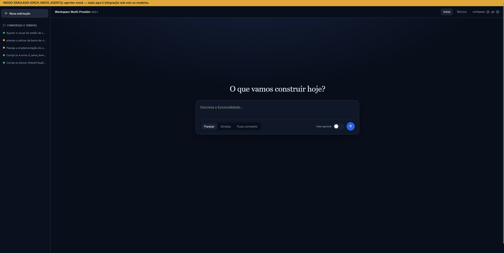
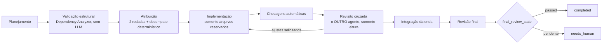

# SINESTRO

[](https://github.com/felipevaleriorocha/sinestro/actions/workflows/ci.yml) [](#roadmap) [](#) [](LICENSE)

[English](README.md) | **Português (Brasil)**

> **Um workspace unificado para colaboração entre IAs.**

O SINESTRO é um **orquestrador multiagente local e autônomo** para coordenar fluxos de engenharia de software com agentes de IA que planejam, implementam e **revisam o trabalho uns dos outros**. Os agentes se comunicam pelo protocolo **A2A 1.0**, utilizando contratos de dados estruturados e validação determinística, sem depender de conversas livres e desestruturadas.



> **Regra central:** quem implementa uma tarefa nunca revisa o próprio trabalho. A revisão cruzada é atribuída a outro agente independente.

## Implementação atual

| Agente | Canal de execução | Configuração principal |
|---|---|---|
| **Gemini** | Antigravity CLI (`agy`), por meio de subprocesso controlado | `AGY_MODEL` |
| **DeepSeek** | API HTTP local / OpenCode Engine | `OPENCODE_MODEL` |

Modelos e provedores são configurados declarativamente por variáveis de ambiente (`.env`). O núcleo de orquestração não deve permanecer permanentemente acoplado a um modelo específico.

**Versão atual:** `0.5.2` · **Schema SQLite:** `7`

A implementação atual inclui análise estática de dependências por meio do **Dependency Analyzer**, execução determinística e sequencial por padrão (`PARALLEL_EXECUTION=false`), rastreabilidade de etapas por `stage_log` e suporte ao isolamento de recursos e ferramentas externas via **Model Context Protocol (MCP)**.

> **Em desenvolvimento:** o SINESTRO está em desenvolvimento ativo. Funcionalidades, configurações e APIs podem mudar. O workspace multi-provider descrito no roadmap representa a direção do projeto; nem todos os recursos planejados já estão implementados.

## Fluxo de execução de tarefas

```text
1. Planejamento              O agente planejador divide o objetivo em subtarefas estruturadas com critérios verificáveis de aceitação.
2. Validação estrutural      O Dependency Analyzer valida o DAG sem utilizar LLM; se houver falha, permite uma tentativa de reformulação do plano.
3. Atribuição                Rodada 1: um agente propõe a atribuição. Rodada 2: o outro agente aceita ou apresenta uma contestação técnica.
                             O desempate determinístico utiliza config/assignment_rules.json.
4. Implementação             O agente atribuído trabalha estritamente nos arquivos e recursos reservados.
5. Checagens automáticas     Linters, analisadores estáticos e testes locais são executados antes das revisões por LLM.
6. Revisão cruzada           O OUTRO agente revisa em modo somente leitura, apresentando evidências precisas: arquivo, linha e trecho do código.
7. Integração da onda        Checagens automáticas validam o conjunto de arquivos produzido pelo grupo topológico.
8. Revisão final             A revisão global verifica interfaces, contratos, consistência e estado compartilhado.
```



Hierarquia para resolução de divergências: **checagens automáticas > revisor com evidências verificáveis > escalonamento humano (`needs_human`)**.

## Estados da revisão final

O campo `final_review_state` é persistido explicitamente. A função pura `final_status()`, em `orchestrator/task_manager.py`, é a autoridade única para as transições de status do workflow:

| `final_review_state` | Status do workflow (com subtarefas aprovadas) |
|---|---|
| `passed` | `completed` |
| `disabled` (`FINAL_REVIEW=false`) | `completed` (com indicação de que a revisão final está desativada) |
| `accepted_by_human` | `completed` |
| `skipped` / `failed` | `completed_unreviewed` (**Retomar** executa somente a revisão final pendente) |
| `changes_requested` / `rejected` / `unverified` / `invalidated` | `needs_human` |
| `rejected_by_human` | `failed` |

Se todas as subtarefas forem implementadas por um único agente, o outro agente assume integralmente a revisão final. Quando houver autoria mista, a aprovação do revisor se aplica somente às tarefas implementadas pelo outro agente. As tarefas de autoria própria são registradas explicitamente em `self_authored_subtasks`, garantindo cobertura auditável.

## Pré-requisitos

- Python 3.11 ou superior (`py -3 --version` ou `python3 --version`).
- Antigravity CLI (`agy`) configurado e autenticado.
- OpenCode Engine ou servidor de inferência local compatível.
- Git disponível no `PATH` (utilizado estritamente em **modo somente leitura** para snapshots e diffs).
- Opcional: ferramentas locais de análise estática e linters (configurados em `config/checks.json`).
- Opcional: Node.js (somente para a suíte de testes de renderização estática do dashboard).

## Início rápido (sem `agy` nem OpenCode)

Os agentes simulados (mock) executam o workflow completo, o painel e a API sem modelo, token ou CLI externo. Nada neste modo é integração real.

```bash
python -m venv .venv && .venv/bin/python -m pip install -r requirements.txt   # Windows: .venv\Scripts\python
cp -n .env.example .env   # depois defina ORCH_MOCK_AGENTS=true (PROJECT_ROOT é opcional: escolha ou crie o projeto pelo painel)
.venv/bin/python run_server.py                                      # Windows: .venv\Scripts\python
```

Abra <http://127.0.0.1:8787/dashboard/> e envie um objetivo, ou pelo terminal:

```bash
curl -X POST http://127.0.0.1:8787/tasks -H "Content-Type: application/json" \
     -d '{"goal": "Criar um módulo hello-world", "mode": "full"}'
```

Veja [docs/DEMO.pt-BR.md](docs/DEMO.pt-BR.md) para um roteiro guiado.

## Instalação e inicialização

```bash
git clone <url-do-repositorio> sinestro
cd sinestro
cp -n .env.example .env  # Configure as credenciais necessárias (PROJECT_ROOT é opcional: dá para escolher o projeto pelo painel)
```

No Windows (PowerShell):

```powershell
# Terminal 1: backend de suporte do OpenCode (quando aplicável)
.\run_opencode.ps1

# Terminal 2: orquestrador (cria o .venv e instala as dependências na primeira execução)
.\start.ps1
```

Após iniciar o serviço:

- **Painel de operações:** <http://127.0.0.1:8787/dashboard/>
- **Documentação da API (OpenAPI/Swagger):** <http://127.0.0.1:8787/docs>

## Scripts de inicialização (Windows)

| Script | O que faz |
|---|---|
| `start.bat` | Inicia o OpenCode e o orquestrador em segundo plano (headless) e abre o painel quando o `/health` responde. |
| `stop.bat` | Encerra tudo que estiver escutando nas portas 8787 (orquestrador), 4096 (OpenCode) e 34872 (Rojo). |
| `restart.bat` | `stop.bat` seguido de `start.bat`. |
| `start.ps1` | Inicia só o orquestrador em primeiro plano (cria o `.venv` e instala as dependências na primeira execução). Também inicia o `rojo serve` quando o `PROJECT_ROOT` tem `default.project.json`. |
| `run_opencode.ps1` | Inicia só o servidor OpenCode local, restrito a `127.0.0.1`. |
| `scripts/run_tests.ps1` | Suíte de testes com mocks; `-Live` adiciona checagens reais de infraestrutura sem tokens, e `-LiveTokens` também envia prompts (consome cota). |
| `python run_server.py` | Forma multiplataforma de iniciar o orquestrador (é o que o `start.ps1` chama). |

## Configuração do ambiente (`.env`)

O arquivo `.env` contém configurações locais e segredos. **Nunca o versione no Git.**

| Variável | Padrão | Descrição |
|---|---|---|
| `PROJECT_ROOT` | — | Opcional. Caminho absoluto do workspace gerenciado. Se vazio, escolha pelo painel (**Abrir pasta…** abre o explorador de arquivos) ou crie um novo; a escolha é gravada aqui. |
| `DEFAULT_PROJECTS_DIR` | `~/Documents/Sinestro` | Onde **Criar novo projeto** cria as pastas. |
| `OPENCODE_URL` | `http://127.0.0.1:4096` | Endpoint do servidor local de desenvolvimento. |
| `OPENCODE_MODEL` | `opencode/deepseek-v4.1-flash-free` | Identificador do modelo (`provider/model`). |
| `OPENCODE_AGENT` | `Build` | Persona operacional de implementação. |
| `OPENCODE_REVIEW_AGENT` | `Plan` | Persona somente leitura para planejamento e análise. |
| `AGY_BIN` | `agy` | Executável ou wrapper da CLI. |
| `AGY_MODEL` | `gemini-4-argon-high` | Modelo principal de raciocínio e arquitetura. |
| `AGY_REVIEW_MODE` | `plan` | Flag `--mode` utilizada em tarefas estritamente analíticas. |
| `PARALLEL_EXECUTION` | `false` | Habilita concorrência entre subtarefas independentes (padrão seguro: desabilitado). |
| `MAX_PARALLEL_SUBTASKS` | `1` | Número máximo de subtarefas simultâneas. |
| `MAX_REVIEW_CYCLES` | `2` | Número máximo de ciclos de correção solicitados pelo revisor. |
| `MAX_CHECK_FIX_ATTEMPTS` | `2` | Tentativas automáticas de correção após falhas de linters/checagens. |
| `MAX_IMPLEMENTATION_ATTEMPTS` | `4` | Limite global de tentativas por subtarefa antes do escalonamento. |
| `MAX_BLOCKED_SUBTASKS` | `3` | Limite defensivo de subtarefas bloqueadas antes de pausar o workflow. |
| `FINAL_REVIEW` | `true` | Habilita a etapa global de integração e validação final. |
| `ORCH_MOCK_AGENTS` | `false` | Defina como `true` para utilizar agentes simulados em memória nos testes de fluxo. |

## Dependency Analyzer: DAG determinístico de tarefas

Antes de executar ou delegar código, o plano é analisado pelo `DependencyAnalyzer` (`orchestrator/dependency_analyzer.py`). Ele não invoca modelos de linguagem nem executa processos.

1. **Validação estrutural:** identifica e bloqueia IDs vazios, IDs duplicados, referências inexistentes em `depends_on`, ciclos de dependência e caminhos externos ao workspace.
2. **Classificação estática das relações:**
   - `PARALLEL`: grafos independentes, sem dependência mútua ou compartilhamento de arquivos/recursos.
   - `SEQUENTIAL`: dependência explícita, incerteza técnica declarada ou carregamento dinâmico exige execução ordenada.
   - `SHARED`: subtarefas compartilham arquivos, contratos, schemas de persistência ou recursos MCP.
3. **Agrupamento em ondas topológicas:** organiza a execução em grupos ordenados. Mesmo no modo sequencial, os grupos determinam a ordem de reserva de recursos e os limites das checagens de integração.

## API REST

| Ação | Método / endpoint | Payload / descrição |
|---|---|---|
| Iniciar workflow | `POST /tasks` | `{"goal": "...", "mode": "plan_only" \| "full"}` |
| Consultar workflow | `GET /tasks/{id}` | Retorna status, DAG, eventos, métricas e etapas. |
| Reanalisar plano | `POST /tasks/{id}/analyze` | Recalcula relações e grupos topológicos sem LLM. |
| Consultar relatório operacional | `GET /tasks/{id}/report` | Consolida etapas, arquivos modificados e métricas. |
| Retomar workflow | `POST /tasks/{id}/resume` | Retoma workflows bloqueados, pausados ou pendentes de revisão. |
| Decidir sobre subtarefa | `POST /tasks/{id}/subtasks/{sid}/decision` | Ação humana: `approve`, `retry`, `reassign` ou `reject`. |
| Decidir sobre revisão final | `POST /tasks/{id}/final-review/decision` | Ação humana: `accept` ou `reject`. |
| Cancelar workflow | `POST /tasks/{id}/cancel` | Solicita cancelamento seguro e registra a auditoria da parada. |
| Liberar cota de agente | `POST /agents/{name}/clear-quota` | Redefine um cooldown persistido após a normalização da cota. |
| Status das integrações | `GET /checks/status` | Lista as ferramentas de validação instaladas e ativas. |
| Projeto (workspace) | `GET /workspace`, `POST /workspace/pick`, `POST /workspace/select`, `POST /workspace/create` | Lê o projeto atual, abre o explorador de arquivos, seleciona uma pasta ou cria uma em `DEFAULT_PROJECTS_DIR`. Recusado enquanto um workflow roda; `POST /tasks` responde `409 project_root_required` até haver um projeto. |
| Gerenciador de locks | `GET /locks`, `GET /locks/history` | Exibe recursos reservados no momento e o histórico de auditoria. |

## Testes e validação

Execute a suíte completa de testes unitários e de integração com mocks:

```powershell
.\scripts\run_tests.ps1
```

Execute testes de integração da infraestrutura local sem consumir tokens de modelos:

```powershell
.\scripts\run_tests.ps1 -Live
```

Execute um teste operacional ponta a ponta com modelos reais (consome cota; utilize um workspace isolado):

```powershell
.\scripts\manual_role_test.ps1 -Implementer deepseek
.\scripts\manual_role_test.ps1 -Implementer gemini
```

## Segurança e concorrência

- **Isolamento de rede:** o serviço expõe endpoints exclusivamente em `127.0.0.1`.
- **Sanitização de dados:** chaves, senhas e cabeçalhos de autenticação são ocultados antes de serem registrados em logs ou no banco de dados.
- **Limite do workspace:** caminhos absolutos ou relativos fora de `PROJECT_ROOT` são rejeitados pelas camadas de validação.
- **Subprocessos controlados:** não são utilizados interpretadores de shell arbitrários; os executáveis recebem listas permitidas de argumentos validados.
- **Reservas atômicas (`FileLockManager`):** reserva transacional do tipo "tudo ou nada" para arquivos e recursos `mcp:`, com retenção preventiva de locks quando não é possível confirmar o encerramento de um processo externo.

## Decisões de design

- **Revisão cruzada, nunca autorrevisão.** Um modelo que revisa a própria saída tende a concordar consigo mesmo. Implementador e revisor são sempre agentes diferentes, e o revisor precisa citar arquivo, linha e trecho de código.
- **O DAG de tarefas é validado sem LLM.** Ciclos, IDs duplicados, referências ausentes e caminhos fora do workspace são fatos estruturais; um analisador determinístico (`orchestrator/dependency_analyzer.py`) é mais barato, reproduzível e testável.
- **Sequencial por padrão.** Subtarefas paralelas exigem isolamento comprovado de arquivos e recursos. Até a reconciliação de locks ser auditada, `PARALLEL_EXECUTION=false` é o padrão seguro.
- **Checagens automáticas valem mais que opiniões.** Linters e testes rodam antes de qualquer revisão por LLM, e uma checagem verificável vence a alegação de um revisor.
- **Locks falham de forma segura.** Se não for possível confirmar o encerramento de um processo externo, a reserva é retida (`expired_retained`) em vez de liberada.
- **Somente loopback.** O serviço escuta em `127.0.0.1` e recusa qualquer outro `ORCH_HOST`.
- **Domínios passivos.** As regras de domínio (ex.: Roblox/Luau) ficam em um `DomainProfile`; o núcleo permanece agnóstico. Veja [docs/ARCHITECTURE.pt-BR.md](docs/ARCHITECTURE.pt-BR.md).

## Roadmap

### Concluído (v0.5.x)

- [x] Validação estrutural determinística de dependências e ondas topológicas.
- [x] Persistência do histórico de etapas (`stage_log`) e retenção de locks (`expired_retained`).
- [x] Interface `DomainProfile`; regras de Roblox extraídas para `domains/roblox/`.
- [x] Abstração Provider/Model/Agent com `CapabilityRegistry` (provedores Gemini, OpenCode e mock).
- [x] Roteamento de tarefas orientado a dados e recuperação híbrida local (`memory/vector_store.py`).

### Próximos passos

- [ ] Encerramento auditado de processos externos e reconciliação de locks retidos.
- [ ] Paralelismo experimental e controlado (`PARALLEL_EXECUTION=true`).
- [ ] Novos perfis de domínio (pipelines de dados, automação, análise técnica).
- [ ] Mais provedores (OpenAI, Anthropic, inferência local via Ollama/vLLM) sobre a interface `Provider` existente.
- [ ] Gateway unificado de permissões, execução e reserva de ferramentas via MCP.

## Estrutura do repositório

```text
agents/          Adaptadores de modelos, contratos de agentes e controle de cotas (Gemini, OpenCode, mocks)
api/             Rotas REST FastAPI, injeção de dependências e ciclo de vida da aplicação
communication/   Servidor/cliente A2A (a2a-sdk), Agent Cards e mensageria estruturada
config/          Políticas de dependência, regras de atribuição e checagens automáticas
core/            Configurações de ambiente, logging sanitizado e gerenciamento seguro de processos
database/        Modelos SQLite (schema 7), migrações aditivas e repositório central
dashboard/       Interface web estática de operações (HTML/CSS/JS, sem dependências externas)
mcp_bridge/      Registro e verificação de saúde de servidores MCP
memory/          Gerenciamento de contexto e repositório auditável de decisões técnicas
orchestrator/    Dependency Analyzer, coordenador de workflow, gerenciador de locks e schemas
scripts/         Automação de testes, validações e scripts de inicialização
tests/           Testes unitários, testes de integração e mocks
tools/           Utilitários de diagnóstico, verificação e testes ponta a ponta
```

## Licença

Este projeto está licenciado sob a licença MIT. Consulte o arquivo [LICENSE](LICENSE) para mais detalhes.
